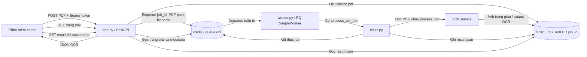

# Data flow của API OCR

Thư mục này chứa lớp HTTP, cấu hình, worker RQ và tác vụ nối với pipeline OCR.
Luồng chính là: phần mềm gọi API gửi PDF; API lưu PDF trên đĩa và đưa thông tin
job vào Redis; worker lấy job, chạy OCR, rồi ghi JSON vào thư mục riêng của job.

## Sơ đồ tổng quan



Redis chỉ giữ job, trạng thái, metadata và tham chiếu cần thiết. PDF nguồn,
output trung gian và JSON kết quả nằm trên filesystem trong thư mục job; API
và worker phải nhìn thấy cùng `OCR_JOB_ROOT`.

## Luồng upload và enqueue

1. `app.py` nhận `POST /api/v1/jobs` và kiểm tra Bearer token.
2. API tạo `job_id` dạng UUID hex, tạo thư mục
   `OCR_JOB_ROOT/<job_id>/`, rồi ghi PDF thành `source.pdf`.
3. API kiểm tra giới hạn dung lượng, chữ ký `%PDF-`, khả năng đọc PDF và số
   trang.
4. API enqueue `process_ocr_job` vào queue tên `RQ_QUEUE_NAME` (mặc định
   `ocr`). Job truyền `job_id`, đường dẫn PDF và tên file; metadata gồm tên
   file, số trang và thời điểm tạo. PDF bytes không được đưa vào Redis.
5. API trả HTTP `202` cùng `job_id` và trạng thái ban đầu `queued`.

Nếu upload hoặc enqueue phát sinh lỗi, API xóa thư mục job vừa tạo rồi trả lỗi.

## Luồng xử lý OCR

1. `worker.py` kết nối Redis, lắng nghe queue `ocr` bằng RQ `SimpleWorker`.
   Một worker xử lý từng job một.
2. Worker gọi `process_ocr_job` trong `tasks.py`.
3. Tác vụ kiểm tra lại đường dẫn và file nguồn, tạo thư mục `ocr_output/`, rồi
   khởi tạo `OCRService` khi cần và gọi `process_pdf`.
4. Tác vụ bỏ trường debug, chuẩn hóa metadata nguồn PDF, thêm `job_id` và ghi
   JSON vào `OCR_JOB_ROOT/<job_id>/result.json`.
5. Hàm tác vụ trả về một tham chiếu nhỏ tới file kết quả; payload OCR lớn không
   được trả về Redis.

## Poll trạng thái và lấy kết quả

- `GET /api/v1/jobs/{job_id}`: `app.py` đọc job từ Redis và chuyển trạng thái
  RQ thành các giá trị API như `queued`, `running`, `succeeded` hoặc `failed`.
- `GET /api/v1/jobs/{job_id}/result`: API chỉ đọc và trả `result.json` khi job
  đã thành công; job chưa xong trả `409`, job hoặc file kết quả không tồn tại
  trả `404`.
- Job endpoints yêu cầu Bearer token. Health endpoint `/health` gọi `PING`
  Redis để xác nhận API kết nối được queue.

API không có endpoint liệt kê job hoặc callback. Phần mềm gọi API cần lưu
`job_id` nhận được từ upload, poll endpoint trạng thái và gọi endpoint result
khi job thành công.

## Vai trò các file

| File | Trách nhiệm |
|---|---|
| `settings.py` | Đọc cấu hình từ environment: Redis, token, đường dẫn job/config, giới hạn upload, retention và timeout. |
| `app.py` | Tạo FastAPI app, xác thực, nhận upload, enqueue job, trả trạng thái và JSON. |
| `worker.py` | Kết nối Redis và chạy một RQ worker tuần tự. |
| `tasks.py` | Kiểm tra input, gọi OCRService, làm sạch dữ liệu kết quả và ghi `result.json`. |
| `cleanup.py` | Preview hoặc xóa thủ công thư mục job quá hạn; mặc định chỉ liệt kê, `--apply` mới xóa. |

## Cấu hình liên quan

Các giá trị mặc định được đọc khi module được import:

| Biến | Ý nghĩa |
|---|---|
| `REDIS_URL` | Redis URL, mặc định `redis://127.0.0.1:6379/0`. |
| `RQ_QUEUE_NAME` | Tên queue, mặc định `ocr`. |
| `OCR_API_TOKEN` | Bearer token bắt buộc cho job endpoints. |
| `OCR_JOB_ROOT` | Gốc lưu PDF, output và JSON; mặc định `output/ocr_api/jobs`. |
| `OCR_CONFIG_PATH` | Cấu hình OCR; mặc định `config/ocr.json`. |
| `MAX_UPLOAD_MB` / `MAX_PDF_PAGES` | Giới hạn upload và số trang. |
| `JOB_RETENTION_DAYS` | Thời gian giữ metadata/result/failure trong RQ và ngưỡng cleanup file. |
| `JOB_TIMEOUT_SECONDS` | Timeout của một job RQ. |

API và worker phải dùng cùng `REDIS_URL`, `OCR_JOB_ROOT` và `OCR_CONFIG_PATH`.
Chỉ API cần `OCR_API_TOKEN` để xác thực request.

## Cleanup

`cleanup.py` chỉ xét thư mục job có ID dạng 32 ký tự, đã quá retention và job
đã kết thúc hoặc không còn trong Redis. Job queued/running được giữ lại. Chạy
preview mặc định bằng:

```powershell
.\.venv\Scripts\python.exe -m src.api.cleanup
```

Chỉ thêm `--apply` sau khi xem đúng danh sách cần xóa:

```powershell
.\.venv\Scripts\python.exe -m src.api.cleanup --apply
```
